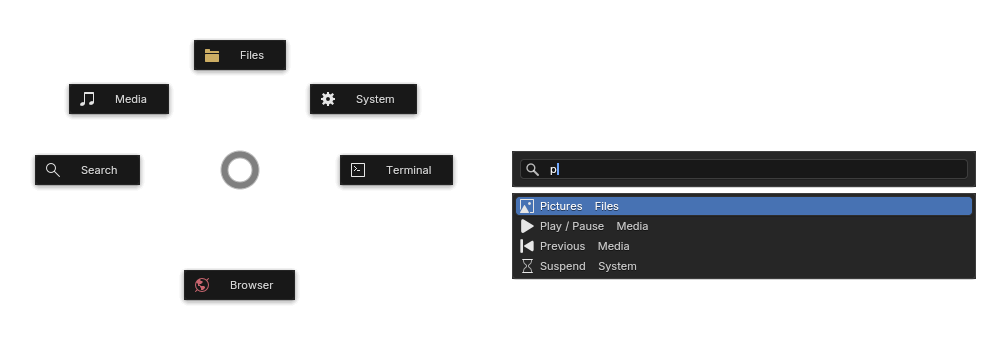

# builauncher

A pie-menu launcher drawn with [BUI](https://github.com/ppmpreetham/BUI), Blender's UI as a
library, in a Qt window through PySide6 (Qt for Python; PyQt is not used). Press a hotkey,
flick towards an item, or type to search every command and installed app.

## Install

    uv tool install builauncher   # or: pipx install builauncher, or uvx builauncher to try it
    builauncher install           # start the daemon at every login
    builauncher daemon &          # start it now, for this session

Then press Ctrl+Alt+Space. `builauncher uninstall` removes the login entries. Run `install`
from an installed copy, not from `uvx`: the environment `uvx` makes is temporary.

## Use

| Input | Result |
| --- | --- |
| Hotkey | Open the pie. The hotkey again closes it. |
| Hold the hotkey, move the pointer, release | Run the item in that direction. |
| Drag from the empty middle | Run the item in the drag direction. |
| Drag and wait on a sub-pie item or Back | Open it, and keep dragging from there. |
| Click an item | Run it, or open its sub-pie. |
| Click the pie centre | Back to the parent pie. |
| Search item, or start typing | Search menu commands and installed apps. |
| Up, Down, Return | Pick a result and run it. |
| Backspace on an empty search, or Tab | Back to the pie. |
| Escape, Alt+F4, a click outside | Close. |

## Commands

| Command | Does |
| --- | --- |
| `builauncher` or `builauncher open` | Open the menu. With no daemon running, it opens once and exits. |
| `builauncher daemon` | Stay running and bind the global shortcut. |
| `builauncher stop` | Stop the running daemon. |
| `builauncher install` | Add the login entry and the app entry (XDG autostart). |
| `builauncher uninstall` | Remove them. |

`open` and `daemon` take `--config FILE`.

## Config

Copy `builauncher/default.toml` to `~/.config/builauncher/menu.toml` and edit it. On Windows,
copy `builauncher/default-windows.toml` to `%APPDATA%\builauncher\menu.toml`.

    shortcut = "CTRL+ALT+space"   # asked for at the first start
    scale = 1.0                   # size of the pie and the search
    apps = true                   # also search installed apps
    dwell = 0.3                   # seconds a drag waits on a submenu or Back before it opens

    [[item]]
    name = "Terminal"
    icon = "CONSOLE"              # a Blender icon name
    exec = "konsole"              # run a command

    [[item]]
    name = "Media"
    icon = "SOUND"
    pie = "media"                 # open the sub-pie named media

    [[pie.media]]
    name = "Next"
    icon = "FF"
    exec = "playerctl next"

An item has either `exec` or `pie`. Each `[[pie.NAME]]` table is one item of that
sub-pie, and its items can open further sub-pies. `pie = "places"` is built in: Home,
Documents, Downloads, Music, Pictures, Videos and the Trash. A `[[pie.places]]` of your
own replaces it.

The top pie holds 7 items, because Search takes one slot. A sub-pie also holds 7,
because Back takes one. A pie that opens itself, directly or through another, is rejected
at load.

## Desktop support
### Linux
The daemon asks the desktop for its shortcut through the
[XDG GlobalShortcuts portal](https://flatpak.github.io/xdg-desktop-portal/docs/doc-org.freedesktop.portal.GlobalShortcuts.html),
which KDE Plasma, GNOME 48 and later, and Hyprland provide. After the first start, change
the shortcut in the desktop's shortcut settings. On a desktop without the portal, bind the
`builauncher` command to a key yourself.

The menu opens under the pointer. On Wayland an app cannot place its window or read the
pointer, so builauncher covers the screen with a transparent window and draws the menu
where the pointer enters it. That window is a layer-shell overlay when Qt has the
layer-shell plugin, and a full-screen window otherwise, so it works on any compositor,
GNOME included. On X11 the window moves to the pointer.

`install` writes an XDG autostart entry. Sway and Hyprland do not run those, so add
`builauncher daemon` to their startup config.

### Windows

The commands and the config are the same. Underneath:

| Linux | Windows |
| --- | --- |
| Shortcut from the XDG portal | `RegisterHotKey`; a timer polls `GetAsyncKeyState` for the release, so hold and release still works. If another app holds the shortcut, the daemon says so. |
| `install` writes an XDG autostart entry | `install` adds a value under `HKCU\Software\Microsoft\Windows\CurrentVersion\Run` that starts the daemon with `pythonw`, so no console opens. |
| Unix socket in `$XDG_RUNTIME_DIR` | Named pipe `\\.\pipe\builauncher` |
| Apps from `.desktop` files | Apps from Start Menu shortcuts |
| `xdg-open`, `trash:///` | `explorer`, `shell:RecycleBinFolder` |
| Transparent full-screen window, menu under the pointer | Frameless, always-on-top window at the pointer |

The Windows default menu uses Windows Terminal (`wt`), sends the media keys through
PowerShell, and locks, sleeps, restarts and shuts down with `rundll32` and `shutdown`.
Sleep hibernates instead when hibernation is on.

## Development

    uv venv --system-site-packages
    uv sync
    uv run pytest
    uv build

## Thanks

- [BUI](https://github.com/ppmpreetham/BUI)
- [Kando](https://github.com/kando-menu/kando)
- [PySide6](https://doc.qt.io/qtforpython-6/)
- [jeepney](https://gitlab.com/takluyver/jeepney)
